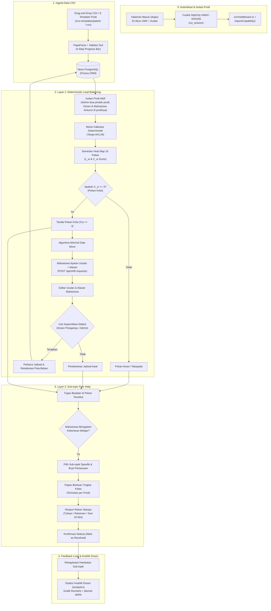
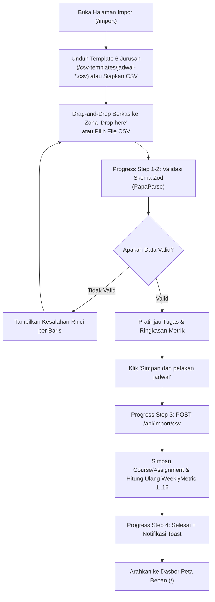
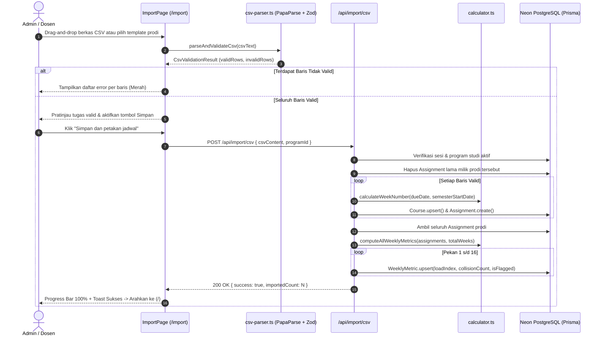
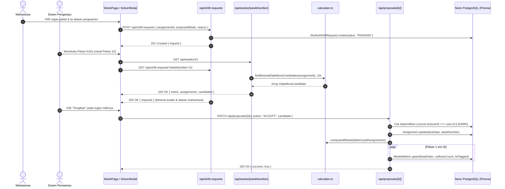
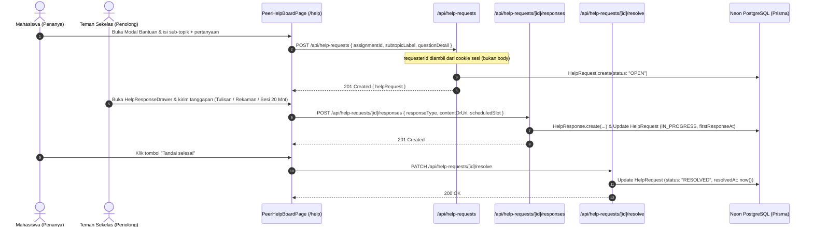
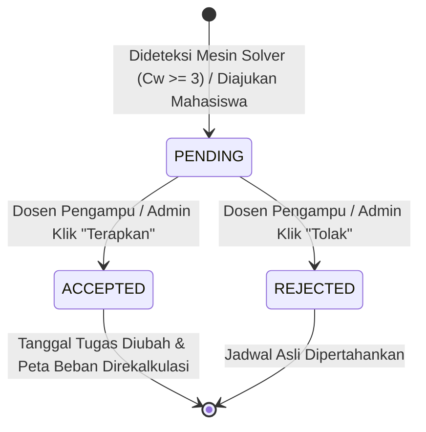
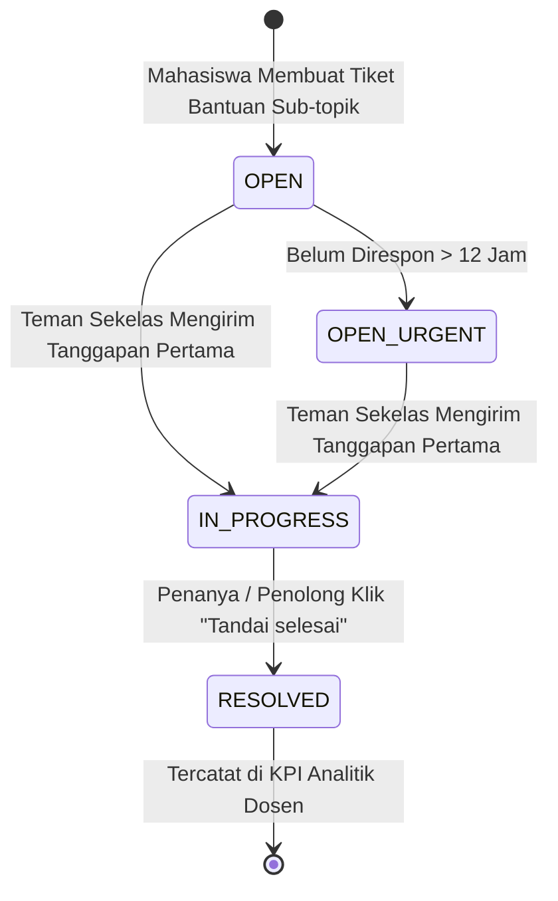
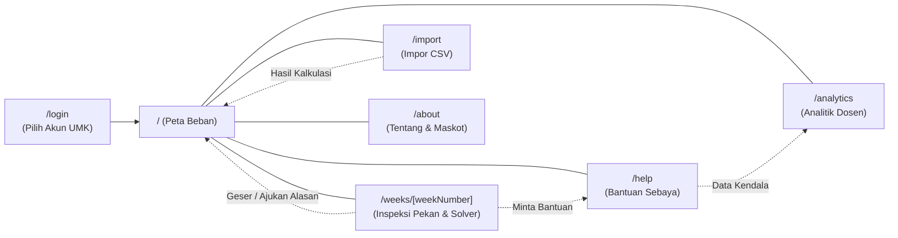

# Diagram & Alur Sistem (Project Flow): Collision Week

> **Platform:** Next.js 14 (App Router) + TypeScript + Prisma 5 (**Neon PostgreSQL**) + Tailwind CSS 3.4 + Recharts + PWA (`sw.js` v3)  
> **Kompetisi:** STACK 2026 by GDGoC ITB — *Case 1: Smarter Campus and Learning*  
> **Tim Pengembang:** `daftar krna gratis`  
> **Dokumen Terkait:** [README.md](file:///e:/ProjectWebsitev2/CollisionWeek/README.md)

---

## 1. Arsitektur Solusi 2-Layer, Isolasi Multi-Jurusan & RBAC

Collision Week menyelesaikan krisis penumpukan tenggat tugas akademik lintas program studi melalui arsitektur komplementer **dua lapis (Two-Layer Architecture)** yang dilengkapi autentikasi cookie bertanda tangan, isolasi prodi (*multi-major*), dan alur aspirasi mahasiswa:

1. **Layer 1 (Pencegahan di Hulu - *Deterministic Scheduling*):** Mengagregasi silabus tugas per program studi (6 jurusan: Teknik Informatika, Sistem Informasi, Teknik Elektro, Teknik Industri, Manajemen, Akuntansi) melalui unggah CSV *drag-and-drop*, menghitung indeks beban dan tabrakan secara matematis murni, menampung usulan pergeseran tanggal beserta alasan dari mahasiswa, serta mengeksekusi pergeseran tanggal terkecil (*minimal date moves*) hanya oleh dosen pengampu mata kuliah terkait atau admin.
2. **Layer 2 (Peredam di Hilir - *Sub-topic Peer Help*):** Mengakomodasi kebuntuan mahasiswa pada tugas di pekan padat melalui papan bantuan sebaya terisolasi per prodi berbasis sub-topik dengan 3 kanal respons inklusif (tulisan, tautan rekaman, dan sesi 20 menit).

---

## 2. Autentikasi, Keamanan Sesi & RBAC

Sistem menggunakan autentikasi demo tanpa kata sandi dengan **otorisasi server-side nyata** agar peran dan program studi tidak dapat dipalsukan dari browser:

1. **Daftar Akun UMK & Foto Profil:** Seluruh 52 akun demo di Neon PostgreSQL memakai domain resmi UMK (`@umk.ac.id` untuk 1 Admin & 11 Dosen, `@std.umk.ac.id` untuk 40 Mahasiswa lintas 6 jurusan) dan dilengkapi foto profil ilustratif (`avatarUrl`) yang dirender oleh komponen `UserAvatar`.
2. **Sesi Cookie HMAC-SHA256 (`cw_session`):** Saat pengguna memilih akun di `/login`, `POST /api/auth/session` memverifikasi ID di database dan menandatangani token ke cookie `httpOnly` menggunakan `SESSION_SECRET`.
3. **Middleware & Capability Gate:**
   * `src/middleware.ts` melindungi seluruh rute halaman (kecuali `/login` dan aset publik) serta mengarahkan pengguna yang belum masuk ke `/login?next=...`.
   * Setiap *route handler* memanggil `requireCapability(...)` (`src/lib/session.ts` & `src/lib/permissions.ts`) untuk membaca ulang peran dan `programId` langsung dari PostgreSQL.
4. **Isolasi Program Studi (6 Jurusan):**
   * Mahasiswa dan Dosen hanya melihat data pekan, mata kuliah, bantuan sebaya, permintaan geser, dan analitik milik program studinya masing-masing (`IF-2027`, `SI-2027`, `TE-2027`, `TI-2027`, `MN-2027`, atau `AK-2027`).
   * Hanya `ADMIN` yang dapat berpindah antar program studi melalui parameter `?programId=`.
5. **Penegakan Kepemilikan Mata Kuliah (*Lecturer Ownership*):**
   * Pada `PATCH /api/proposals/[id]`, dosen hanya dapat menyetujui atau menolak pergeseran tugas untuk mata kuliah yang `lecturerId`-nya sama dengan ID dosen tersebut. Upaya menggeser mata kuliah dosen lain ditolak dengan status `403 Forbidden`.
   * Pada menu cepat `+ Buat Baru` (`CreateContentModal.tsx`), Mahasiswa hanya melihat opsi **Minta bantuan sebaya** dan **Ajukan geser tanggal ke dosen**, sedangkan menu impor CSV, sesi 20 menit, analitik, dan reset data hanya tampil untuk Dosen/Admin.

---

## 3. Alur Pengguna Berdasarkan Persona (User Journey Flows)

### 3.1 Persona 1: Admin / Koordinator & Dosen (Ingesti Jadwal CSV)
Tujuan: Mengimpor kalender tugas akademik satu semester penuh per program studi dengan antarmuka *drag-and-drop* dan pemantauan progres 4 tahap.

---

### 3.2 Persona 2: Dosen Pengampu (Peninjauan Aspirasi, Pergeseran Jadwal & Analitik)
Tujuan: Meninjau alasan permintaan geser dari mahasiswa, menyeimbangkan pekan padat khusus mata kuliah yang diampu, serta memantau kendala sub-topik lewat grafik Recharts.

```mermaid
flowchart TD
    subgraph SkenarioA["Skenario A: Penyeimbangan Beban Pekan"]
        D1["Dosen Membuka Dasbor (/) atau /weeks/10"] --> D2["Melihat Pekan Kritis di Prodinya (Cw >= 3)"]
        D2 --> D3["Membaca Daftar 'Permintaan Geser dari Mahasiswa' + Alasan"]
        D3 --> D4["Melihat Rekomendasi Solver untuk Matkul yang Diampu Sendiri"]
        D4 --> D5{"Keputusan Dosen"}
        D5 -- Klik 'Terapkan' --> D6["API PATCH /api/proposals/[id] (Action: ACCEPT)"]
        D6 --> D7["Verifikasi Kepemilikan Matkul -> Jadwal Diperbarui & Beban Direkalkulasi"]
        D5 -- Klik 'Tolak' --> D8["Pertahankan Jadwal Asli"]
    end

    subgraph SkenarioB["Skenario B: Monitoring Analitik Recharts"]
        D9["Dosen Membuka 'Analitik Dosen' (/analytics)"] --> D10["Melihat Banner WIRA (UMK) & Pilih Matkul"]
        D10 --> D11["Melihat KPI: Total Pertanyaan, Rasio Selesai, Waktu Respons, Sub-topik Kritis"]
        D11 --> D12["Melihat BarChart Sub-topik (Recharts) & Distribusi Format Bantuan"]
        D12 --> D13["Menentukan Materi Review Sebelum Ujian / Praktikum"]
    end
```

---

### 3.3 Persona 3: Mahasiswa (Pengajuan Geser Tanggal & Bantuan Belajar Sebaya)
Tujuan: Mengajukan usulan pergeseran tenggat beserta alasan ke dosen saat pekan menumpuk, serta memecahkan kebuntuan tugas melalui papan bantuan sebaya.

```mermaid
flowchart TD
    subgraph GeserTanggal["Alur Pengajuan Geser Tanggal (Mahasiswa)"]
        S1["Mahasiswa Melihat Pekan Padat (/ atau /weeks/[w])"] --> S2["Buka Solver / Klik '+ Buat Baru' -> Ajukan Geser Tanggal"]
        S2 --> S3["Pilih Tugas & Pekan Usulan"]
        S3 --> S4["Tuliskan Alasan (min. 8 karakter)"]
        S4 --> S5["Kirim ke POST /api/shift-requests"]
        S5 --> S6["Usulan & Alasan Muncul di Panel Dosen Pengampu"]
    end

    subgraph PeerHelp["Alur Bantuan Sebaya (Penanya & Penolong)"]
        M1["Klik 'Minta bantuan' di Pekan atau /help"] --> M2["Pilih Tugas, Sub-topik & Tulis Pertanyaan"]
        M2 --> M3["POST /api/help-requests (Status: OPEN)"]
        M3 --> H1["Teman Sekelas Satu Prodi Membuka Drawer Tanggapan"]
        H1 --> H2{"Pilih Kanal Bantuan"}
        H2 -- Tulisan --> H3["Penjelasan Langkah / Tautan Referensi"]
        H2 -- Rekaman --> H4["Tautan Video (Loom / Drive / YouTube)"]
        H2 -- Sesi 20 Mnt --> H5["Slot Waktu Sesi Diskusi 20 Menit"]
        H3 & H4 & H5 --> H6["POST /api/help-requests/[id]/responses -> Status IN_PROGRESS"]
        H6 --> R1["Penanya / Penolong Klik 'Tandai selesai' -> Status RESOLVED"]
    end
```

---

## 4. Sequence Diagram & State Machine

### 4.1 Sequence 1: Ingesti Jadwal CSV & Rekalkulasi Peta Beban

### 4.2 Sequence 2: Pengajuan Alasan Mahasiswa & Eksekusi Solver Dosen

### 4.3 Sequence 3: Siklus Hidup Permintaan Bantuan Sebaya

### 4.4 State Machine Diagrams

---

## 5. Logika Matematis & Algoritma Deterministik

### 5.1 Perhitungan Beban dan Tabrakan
* **Klasifikasi Tugas:**
  $$\text{is\_major}(a) = \begin{cases} \text{true}, & \text{jika } \text{weight\_score}(a) \ge 3 \\ \text{false}, & \text{jika } \text{weight\_score}(a) < 3 \end{cases}$$
* **Collision Count ($C_w$):** Jumlah mata kuliah unik yang memiliki tugas besar di pekan $w$:
  $$C_w = \left| \{ \text{course\_id} \mid \text{week\_number} = w \land \text{weight\_score} \ge 3 \} \right|$$
* **Load Index ($L_w$):** Akumulasi total bobot seluruh tugas di pekan $w$:
  $$L_w = \sum_{a \in A_w} \text{weight\_score}(a)$$
* **Status Zonasi Semantik:**
  * $C_w \ge 3 \implies$ **Kritis** (`Kritis`)
  * $C_w = 2 \implies$ **Waspada** (`Waspada`)
  * $C_w \le 1 \implies$ **Aman** (`Aman`)

### 5.2 Algoritma Deterministik *Minimal Date Move*
Dijamin **100% deterministik dan bebas halusinasi (tanpa LLM)**:
1. Hentikan jika $C_w < 3$.
2. Ambil tugas besar ($\text{weight\_score} \ge 3$) pada pekan $w$.
3. Uji pergeseran ke pekan tetangga dengan prioritas jarak terdekat: $\Delta w \in \{-1, +1, +2, -2, +3, -3\}$.
4. **Safety Invariant:** Pekan tujuan $w' = w + \Delta w$ tidak boleh menjadi kritis ($C_{w'} < 3$) dan tabrakan di pekan asal harus berkurang ($C_w^{\text{baru}} < C_w^{\text{lama}}$).
5. Urutkan kandidat berdasarkan penurunan $C_w < 3$, $|\Delta w|$ terkecil, dan `loadReductionDelta` terbesar.

---

## 6. Ekosistem Maskot Komunikator, Ilustrasi Editorial & PWA

* **3 Maskot Komunikator Digital (Tanpa Bingkai + Comic Speech Bubble):**
  * **WIRA (UMK — *Newsman*):** Menyampaikan ringkasan status beban semester, informasi impor jadwal CSV, serta ringkasan analitik dosen.
  * **Cody (BINUS — *Schedule Assistant*):** Memandu mahasiswa dan dosen saat memeriksa detail pekan kritis serta opsi penyeimbangan tenggat.
  * **PUTI (Telkom — *Peer-Help Companion*):** Menemani papan bantuan sebaya dan mendorong kolaborasi antar mahasiswa.
  * Seluruh maskot berinteraksi secara kontekstual pada komponen `MascotBanner`, `MascotDialogueShowcase`, halaman `/login`, `/weeks/[weekNumber]`, `/help`, `/analytics`, `/import`, dan `/about`.
* **10 Ilustrasi Topik Editorial (`public/images/topics/*.png`):** Kartu pekan, mata kuliah, dan bantuan sebaya menggunakan ilustrasi datar-isometrik bergaya editorial yang dipetakan dengan pencocokan batas kata (*word-boundary regex*) per kode/nama mata kuliah (`coding.png`, `database-sql.png`, `uiux-web.png`, `statistics-math.png`, `network-db.png`, `study-research.png`, `engineering-lab.png`, `industrial-ops.png`, `management-team.png`, `finance-accounting.png`).
* **Progressive Web App (PWA):** Didukung `public/manifest.json`, `src/components/PWARegister.tsx`, dan `public/sw.js` (`cw-cache-v3` dengan strategi *network-first* untuk HTML serta bundel `_next` agar pembaruan UI selalu segar).

---

## 7. Peta Rute Aplikasi & Penanganan Kasus Khusus

| URL Rute | Komponen Utama | Peran & Hak Akses |
|---|---|---|
| `/login` | `src/app/login/page.tsx`, `UserAvatar.tsx` | Pemilihan akun demo UMK (52 akun dengan avatar, pencarian nama/email, maskot peran). |
| `/` | `src/app/page.tsx`, `HeatMapGrid.tsx`, `WideWeekCard.tsx` | Peta beban 16 pekan, 2 pekan paling padat, dan ringkasan WIRA sesuai prodi pengguna. |
| `/weeks/[weekNumber]` | `src/app/weeks/[weekNumber]/page.tsx`, `DateMoveSolver.tsx` | Carousel 16 pekan (responsif di mobile), daftar tugas, form usulan + alasan mahasiswa, serta eksekusi solver khusus dosen pengampu/admin. |
| `/help` | `src/app/help/page.tsx`, `HelpResponseDrawer.tsx`, `HelpRequestModal.tsx` | Papan bantuan sebaya terisolasi per prodi dengan filter urgensi (>12 jam) dan 3 kanal respons. |
| `/analytics` | `src/app/analytics/page.tsx` | Khusus Dosen & Admin (`analytics.view`). Menampilkan grafik Recharts, KPI respons < 24 jam, dan rekomendasi review materi. |
| `/import` | `src/app/import/page.tsx` | Khusus Dosen & Admin (`schedule.import`). Zona *drag-and-drop*, *progress bar* 4 tahap, 6 template CSV prodi, dan validasi Zod. |
| `/about` | `src/app/about/page.tsx`, `MascotDialogueShowcase` | Profil 3 maskot komunikator digital (WIRA, Cody, PUTI), dialog interaktif, serta ringkasan solusi STACK 2026. |

### Penanganan Kasus Khusus (*Edge Cases*)
1. **Format Berkas CSV Rusak / Kurang Kolom:** `parseAndValidateCsv` memisahkan baris bermasalah ke `invalidRows` beserta nomor baris dan detail validasi Zod; penyimpanan diblokir hingga berkas valid.
2. **Pekan Tetangga Penuh ($C_{w \pm 1} \ge 2$):** Solver otomatis memperluas pencarian hingga $\Delta w = \pm 3$. Jika tetap padat, sistem menampilkan informasi transparan tanpa memaksakan pergeseran.
3. **Pertanyaan *Cold-Start* (> 12 Jam Tanpa Tanggapan):** Tiket berstatus `OPEN` tanpa respons lebih dari 12 jam otomatis ditandai mendesak dan diprioritaskan di paling atas papan bantuan.
4. **Akses Lintas Peran atau Lintas Prodi Ilegal:** Seluruh API memeriksa cookie HMAC-SHA256 di server dan mengembalikan `401`/`403` untuk akses tidak sah.

---

*Dokumen ini merupakan panduan resmi alur operasional dan teknis sistem Collision Week.*
