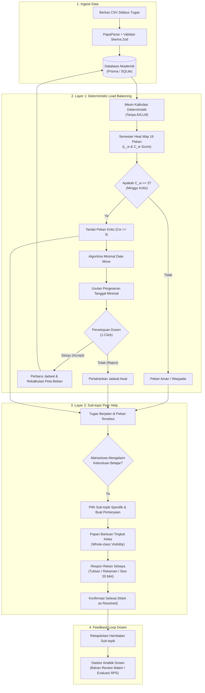
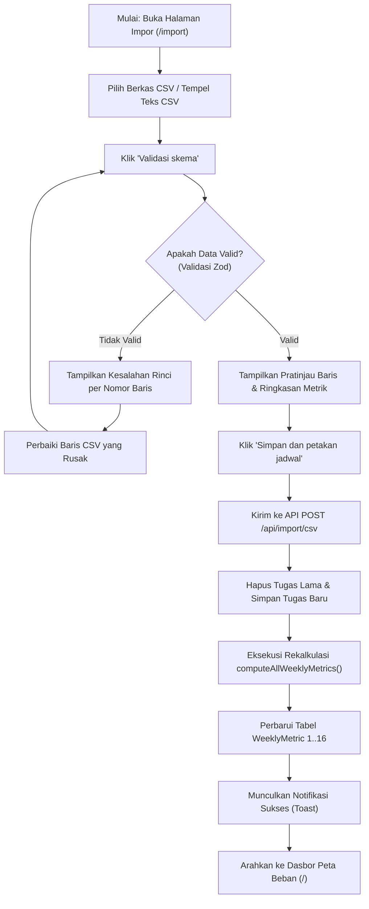
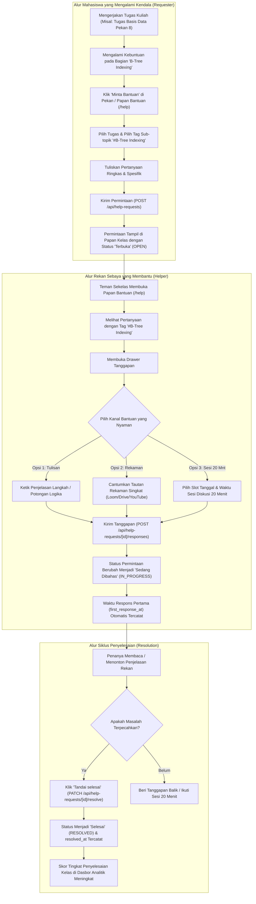
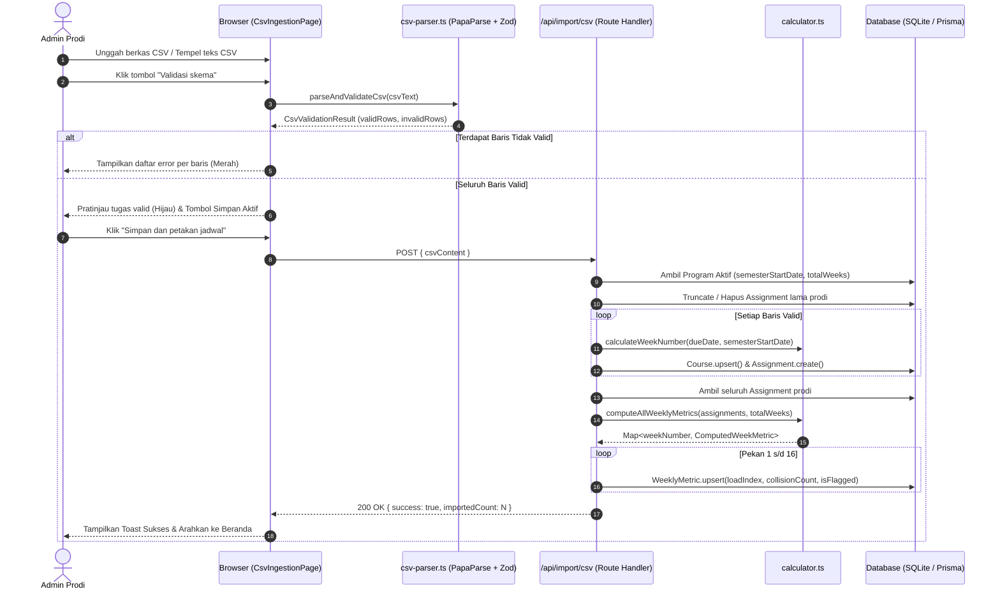
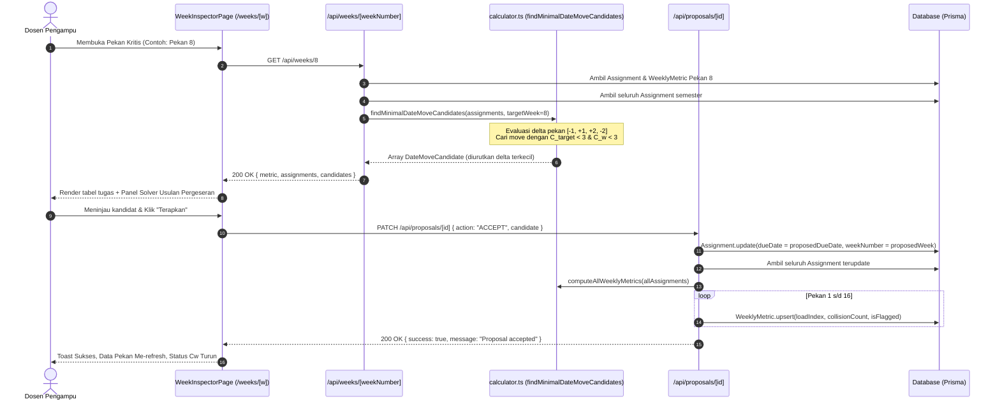
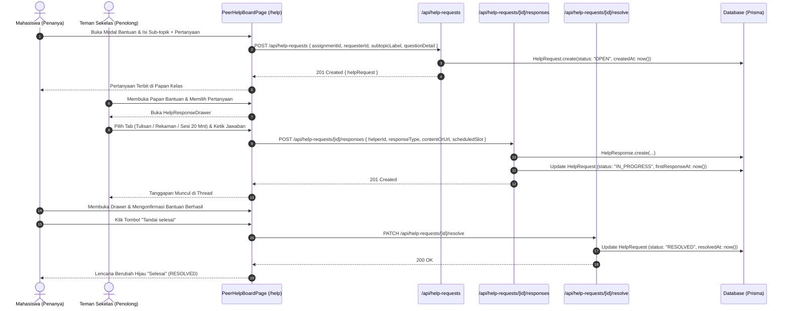
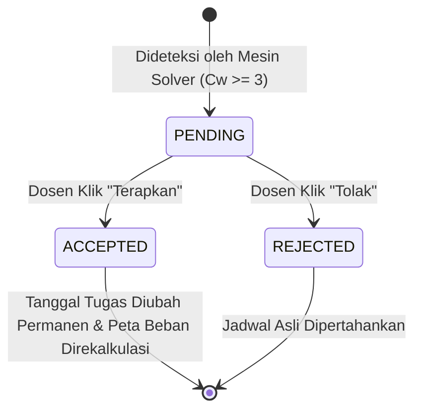
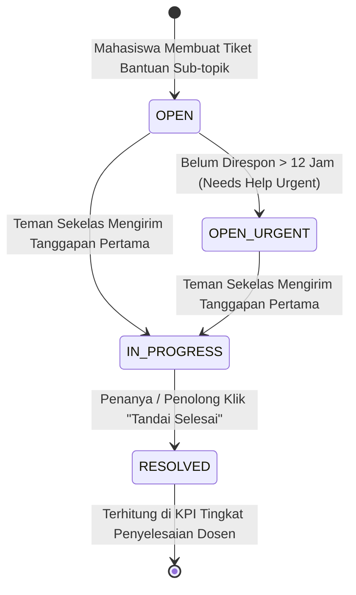
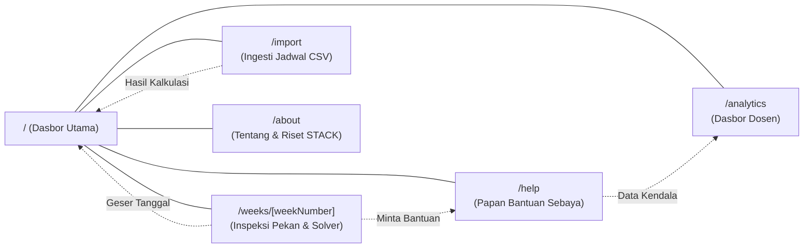

# Diagram & Alur Sistem (Project Flow): Collision Week

> **Platform:** Next.js 14 (App Router) + TypeScript + Prisma 5 (SQLite) + Tailwind CSS 3.4  
> **Kompetisi:** STACK 2026 by GDGoC ITB — *Case 1: Smarter Campus and Learning*  
> **Tim Pengembang:** `daftar krna gratis`  
> **Dokumen Terkait:** [PRD (product_requirements_document_prd_collision_week.md)](file:///e:/ProjectWebsitev2/CollisionWeek/product_requirements_document_prd_collision_week.md) & [UI/UX Spec (UIUX_REDESIGN_SPEC.md)](file:///e:/ProjectWebsitev2/CollisionWeek/UIUX_REDESIGN_SPEC.md)

---

## 1. Arsitektur Solusi 2-Layer (High-Level Overview)

Collision Week menyelesaikan krisis penumpukan tenggat tugas akademik melalui arsitektur komplementer **dua lapis (Two-Layer Architecture)**:
1. **Layer 1 (Pencegahan di Hulu - *Deterministic Scheduling*):** Mengagregasi seluruh silabus tugas satu program studi ke dalam kalender bersama, menghitung indeks beban dan tabrakan secara matematis murni, serta mengusulkan pergeseran tanggal terkecil (*minimal date moves*) untuk disetujui dosen.
2. **Layer 2 (Peredam di Hilir - *Sub-topic Peer Help*):** Mengakomodasi kebuntuan mahasiswa pada tugas-tugas di pekan yang tetap padat melalui forum bantuan sebaya terstruktur berbasis sub-topik dengan 3 kanal respons inklusif (tulisan, rekaman, sesi 20 menit).

---

## 2. Alur Pengguna Berdasarkan Persona (User Journey Flows)

### 2.1 Persona 1: Admin / Koordinator Program Studi (Ingesti Jadwal)
Tujuan: Mengimpor kalender tugas akademik satu semester penuh agar beban kurikulum langsung terpetakan.

---

### 2.2 Persona 2: Dosen Pengampu (Penyeimbangan Beban & Analitik Materi)
Tujuan: Memastikan mahasiswa tidak mengalami *burnout* ekstrem pada pekan ujian/proyek dan mengidentifikasi sub-topik kuliah yang sulit dipahami mahasiswa.

```mermaid
flowchart TD
    subgraph SkenarioA["Skenario A: Penyeimbangan Beban Pekan"]
        D1["Dosen Membuka Dasbor (/)"] --> D2["Melihat Pekan Kritis (Contoh: Pekan 8, Cw = 4)"]
        D2 --> D3["Klik 'Seimbangkan' / Buka /weeks/8"]
        D3 --> D4["Sistem Memuat Tugas & Kandidat Pergeseran"]
        D4 --> D5["Dosen Meninjau Opsi: Misal Geser Proyek Basis Data ke Pekan 9"]
        D5 --> D6["Melihat Dampak Penurunan: Cw Pekan 8 turun dari 4 ke 3, Pekan 9 tetap aman (Cw=2)"]
        D6 --> D7{"Keputusan Dosen"}
        D7 -- Klik 'Terapkan' --> D8["API PATCH /api/proposals/[id] (Action: ACCEPT)"]
        D8 --> D9["Jadwal Diperbarui & Beban Dihitung Ulang Otomatis"]
        D9 --> D10["Peta Beban Berubah Warna Menjadi Aman/Waspada"]
        D7 -- Klik 'Tolak' --> D11["Pertahankan Jadwal Asli"]
    end

    subgraph SkenarioB["Skenario B: Monitoring Evaluasi Materi Kuliah"]
        D12["Dosen Membuka Menu 'Analitik' (/analytics)"] --> D13["Pilih Mata Kuliah yang Diampu (Misal: IF2110)"]
        D13 --> D14["Melihat 4 KPI: Total Pertanyaan, Rasio Selesai, Waktu Respons Awal, Sub-topik Kritis"]
        D14 --> D15["Melihat Peringkat Hambatan Sub-topik (Misal: Normalisasi 3NF, B-Tree Indexing)"]
        D15 --> D16["Membaca Rekomendasi Sistem (Misal: Sediakan sesi asistensi tambahan sebelum ujian)"]
    end
```

---

### 2.3 Persona 3: Mahasiswa (Bantuan Belajar Sebaya Berbasis Sub-topik)
Tujuan: Memecahkan kebuntuan pengerjaan tugas tanpa canggung, menemukan teman sekelas yang paham, serta saling membantu secara asinkron maupun mikro-sesi.

---

## 3. Sequence Diagram (Detail Interaksi Komponen & API)

### 3.1 Sequence 1: Ingesti Jadwal CSV & Rekalkulasi Peta Beban
Menunjukkan bagaimana file CSV diproses secara deterministik oleh server Next.js dan Prisma ORM.

---

### 3.2 Sequence 2: Solver Deterministik & Eksekusi Pergeseran Tanggal
Menunjukkan eksekusi algoritma *Minimal Date Move* tanpa AI/LLM.

---

### 3.3 Sequence 3: Siklus Hidup Permintaan Bantuan Sebaya (Peer Help Lifecycle)
Menunjukkan siklus penanganan kebuntuan belajar dari pembukaan hingga status *Resolved*.

---

## 4. State Machine Diagram

### 4.1 State Machine: Status Usulan Pergeseran Tanggal (Date Move Proposal)

### 4.2 State Machine: Siklus Hidup Permintaan Bantuan (Help Request)

---

## 5. Logika Matematis & Algoritma di Balik Alur

### 5.1 Perhitungan Beban dan Tabrakan (PRD 5.2)
* **Klasifikasi Tugas:**
  $$\text{is\_major}(a) = \begin{cases} \text{true}, & \text{jika } \text{weight\_score}(a) \ge 3 \\ \text{false}, & \text{jika } \text{weight\_score}(a) < 3 \end{cases}$$
* **Collision Count ($C_w$):** Menghitung jumlah mata kuliah unik yang memiliki tugas besar di pekan $w$:
  $$C_w = \left| \{ \text{course\_id} \mid \text{week\_number} = w \land \text{weight\_score} \ge 3 \} \right|$$
* **Load Index ($L_w$):** Akumulasi total bobot seluruh tugas di pekan $w$:
  $$L_w = \sum_{a \in A_w} \text{weight\_score}(a)$$
* **Status Zonasi Semantik:**
  * $C_w \ge 3 \implies$ **Kritis (*Flagged*)** (Merah Kirmizi, badge: `Kritis`)
  * $C_w = 2 \implies$ **Waspada (*Caution*)** (Kuning Emas, badge: `Waspada`)
  * $C_w \le 1 \implies$ **Aman (*Safe*)** (Hijau Zamrud, badge: `Aman`)

### 5.2 Algoritma Deterministik *Minimal Date Move*
Algoritma ini dijamin **100% deterministik, konsisten, dan bebas halusinasi (tanpa LLM)**:
1. **Identifikasi Masalah:** Jika $C_w < 3$, hentikan (pekan sudah seimbang).
2. **Filter Tugas Kandidat:** Ambil tugas besar ($\text{weight\_score} \ge 3$) di pekan $w$.
3. **Eksplorasi Tetangga:** Uji pergeseran hari/pekan dengan prioritas jarak terdekat:
   $$\Delta w \in \{-1, +1, +2, -2, +3, -3\}$$
4. **Validasi Invariant Keamanan (Safety Invariant):**
   * Pekan tujuan $w' = w + \Delta w$ **tidak boleh** menjadi kritis akibat pergeseran ($C_{w'} < 3$).
   * Pergeseran harus menurunkan tabrakan di pekan asal ($C_w^{\text{baru}} < C_w^{\text{lama}}$).
5. **Pengurutan Deterministik (Sorting Tier):**
   * Prioritas 1: Mampu menurunkan $C_w < 3$.
   * Prioritas 2: Jarak perpindahan terkecil ($|\Delta w|$ terkecil).
   * Prioritas 3: Penurunan bobot terbesar ($\text{loadReductionDelta}$).

---

## 6. Peta Rute Aplikasi & Hubungan Antar Layar

| URL Rute | Komponen Utama | Peran Utama di Alur Sistem |
|---|---|---|
| `/` | `src/app/page.tsx`, `HeatMapGrid.tsx`, `WideWeekCard.tsx` | Menampilkan ringkasan semester, 2 pekan paling kritis, dan grid 16 pekan interaktif. |
| `/weeks/[weekNumber]` | `src/app/weeks/[weekNumber]/page.tsx`, `DateMoveSolver.tsx` | Carousel 16 pekan, rincian per-tugas, metrik bobot, dan eksekusi solver geser tanggal. |
| `/help` | `src/app/help/page.tsx`, `HelpResponseDrawer.tsx`, `HelpRequestModal.tsx` | Papan bantuan publik seluruh kelas, filter status kendala (>12 jam), dan formulir 3 kanal jawaban. |
| `/analytics` | `src/app/analytics/page.tsx` | Pelacakan metrik respon bantuan $< 24$ jam, peringkat sub-topik kendala, dan rekomendasi review untuk dosen. |
| `/import` | `src/app/import/page.tsx` | Antarmuka unggah CSV, verifikasi skema baris, eksekusi penyimpanan, dan tombol reset data demo 16 pekan. |
| `/about` | `src/app/about/page.tsx` | Dokumentasi kepatuhan PRD STACK 2026, hasil riset 53 mahasiswa & 3 dosen, profil tim, dan roadmap *Final Day*. |

---

## 7. Penanganan Kasus Khusus (Edge Cases Handling)

1. **Format Berkas CSV Rusak / Kurang Kolom:**
   * Ditangani oleh `parseAndValidateCsv` dengan Zod. Baris yang salah dipisahkan ke dalam `invalidRows` lengkap dengan nomor baris dan keterangan kesalahan spesifik (misal: format tanggal bukan `YYYY-MM-DD` atau bobot di luar rentang 1-5). Tombol simpan dinonaktifkan sampai CSV diperbaiki.
2. **Seluruh Pekan Tetangga Penuh ($C_{w \pm 1} \ge 2$):**
   * Algoritma *Minimal Date Move* otomatis memperluas radius pencarian ke $\Delta w = \pm 2$ atau $\pm 3$. Jika seluruh pekan tetap padat, sistem secara transparan menampilkan status bahwa pergeseran otomatis tidak dimungkinkan tanpa penyesuaian kalender prodi.
3. **Pertanyaan Mahasiswa Mengalami *Cold-Start* (> 12 Jam Tanpa Tanggapan):**
   * Sistem otomatis menghitung durasi `now() - created_at`. Jika berstatus `OPEN` dan $> 12$ jam, tiket diklasifikasikan sebagai `NEEDS_HELP_URGENT` dan ditempatkan pada filter prioritas atas dengan lencana merah *"Butuh bantuan (>12 jam)"*.
4. **Transparansi Fitur *Final Day*:**
   * Fitur yang disisakan untuk babak Final Day (ekstraksi PDF silabus, sinkronisasi otomatis Moodle, dan pencocokan jadwal kalender otomatis) diberi label jelas *"Segera"* / *"Planned for Final Day"* untuk menjaga integritas dan kepatuhan aturan kompetisi.

---

*Dokumen ini merupakan panduan resmi alur operasional dan teknis sistem Collision Week.*
