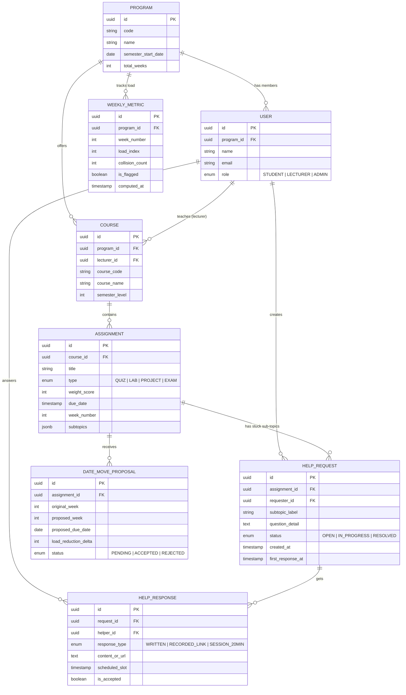

# Product Requirements Document (PRD): Collision Week

| Atribut Dokumen | Detail |
| :--- | :--- |
| **Judul Proyek** | Collision Week: Deadline Load Balancing and Sub-topic Peer Help for Academic Programs |
| **Nama Tim** | `daftar krna gratis` |
| **Ajang & Kategori** | STACK 2026 by GDGoC ITB — *Case 1: Smarter Campus and Learning* |
| **Tema Kompetisi** | *"Agent of the Ocean: Vibing Beyond the Code"* |
| **Target Fase & Tenggat** | Semifinal Phase (30 November 2026, 23:59 WIB) & Final Day (16 Desember 2026) |
| **Tim Pengembang** | Aldiansyah Fayruz (Leader & Backend/Core Logic), Khadijah Passa Alkhansa (Frontend & UI/UX), Khalisha Kaylanasywa (Research, Data & Validation), Shiti Azzahra Eka Rinaldi (PM, Proposal & Video) |
| **Status Dokumen** | v1.0 — Baseline Eksekusi Semifinal |

---

## 1. Ringkasan Eksekutif & Tujuan Produk

### 1.1 Visi Produk
**Collision Week** adalah aplikasi web responsif berbasis kalkulasi deterministik yang mengatasi penumpukan tenggat tugas (*deadline clustering*) lintas mata kuliah dalam satu program studi sekaligus memfasilitasi bantuan sebaya (*peer help*) berbasis sub-topik spesifik pada minggu-minggu padat tersebut.

### 1.2 Selaras dengan Tantangan *Case 1: Smarter Campus and Learning*
Produk ini menjawab pertanyaan utama *Case 1*—*"How might we help students learn, collaborate, and access campus opportunities more effectively?"*—dengan menghadirkan alur pengguna yang jelas, interaksi inti yang berfungsi nyata, serta manfaat terukur berupa penghematan waktu koordinasi jadwal, penurunan minggu dengan tabrakan tugas ekstrem, dan percepatan penyelesaian kebuntuan belajar mahasiswa.

### 1.3 Metrik Keberhasilan Utama (KPI)
1. **Reduksi Minggu Bertabrakan (*Flagged Weeks Reduction*):** Penurunan jumlah minggu dengan $\ge 3$ tugas besar dari mata kuliah berbeda sebelum dan sesudah rekomendasi pergeseran tanggal disetujui dosen.
2. **Kecepatan Respons Pertama (*Time to First Response*):** Mahasiswa yang mengajukan permintaan bantuan sub-topik mendapatkan respons awal dari teman sekelas dalam waktu $< 24$ jam.
3. **Tingkat Penyelesaian Bantuan (*Resolved Requests Rate*):** Persentase permintaan bantuan sub-topik yang ditandai selesai (*resolved*) oleh kedua belah pihak (penanya dan penolong).
4. **Identifikasi Hambatan Akademik:** Dosen memperoleh visibilitas kuantitatif mengenai sub-topik mana yang paling banyak memicu permintaan bantuan di kelasnya.

---

## 2. Latar Belakang Masalah & Bukti Riset

### 2.1 Konteks Masalah
Informasi tenggat tugas selama satu semester tersebar secara terfragmentasi di LMS kampus, Google Classroom, dan grup WhatsApp kelas. Dosen yang menetapkan tenggat hanya melihat jadwal mata kuliahnya sendiri. Meskipun program studi terkadang melakukan koordinasi informal, tidak ada kalender mengikat yang merekam keseluruhan beban semester. Akibatnya, beban tugas menumpuk pada beberapa minggu tertentu, sementara mahasiswa yang mengerjakan tugas yang sama kesulitan menemukan teman sekelas yang sudah memahami sub-topik tempat mereka macet.

### 2.2 Bukti Empiris Tim
Berdasarkan survei tim terhadap **53 mahasiswa dari 48 program studi** dan wawancara semi-terstruktur dengan **3 dosen** pada November 2026:
* **74%** mahasiswa pernah mengalami minggu dengan **3 atau lebih** tugas besar jatuh tempo bersamaan.
* **15%** mahasiswa melaporkan mengalami **5 atau lebih** tugas besar dalam satu minggu.
* **60%** mahasiswa tidur **5 jam atau kurang** per hari selama minggu penumpukan tugas tersebut.
* **85%** mahasiswa memilih bertanya kepada teman dekat saat kesulitan mengerjakan tugas, namun **62%** tidak dapat mengetahui siapa saja di kelasnya yang sudah menyelesaikan atau memahami bagian tugas tertentu.
* **3 dosen** mengonfirmasi bahwa koordinasi jadwal tugas antar-pengampu bersifat informal dan tidak merata tanpa kalender terpadu, serta mengakui mahasiswa lebih nyaman bertanya kepada rekan sebaya.

### 2.3 Analisis Alternatif yang Ada (*Competitive Landscape*)

| Solusi yang Ada | Keterbatasan Utama | Keunggulan Pembeda *Collision Week* |
| :--- | :--- | :--- |
| **Kalender LMS per Mata Kuliah** (Moodle, Google Classroom) | Terisolasi per mata kuliah; tidak menyimpan data lintas pendaftaran (*enrolment*) satu angkatan sehingga tidak bisa mendeteksi tabrakan beban mingguan. | Mengagregasi seluruh mata kuliah dalam satu program studi ke dalam *Semester Heat Map* dan menghitung *Load Index* serta *Collision Count*. |
| **Kalender Umum** (Google Calendar, Notion) | Bersifat pasif; hanya menampilkan tanggal tanpa pembobotan kesulitan tugas maupun algoritma saran pergeseran jadwal. | Menghitung beban berbobot secara deterministik dan mengusulkan himpunan pergeseran tanggal terkecil (*minimal date moves*) untuk disetujui dosen. |
| **Aplikasi *Study-Buddy* Umum** | Mencocokkan teman belajar hanya berdasarkan mata kuliah atau minat umum tanpa konteks tugas spesifik. | Mencocokkan mahasiswa berdasarkan **sub-topik spesifik** di dalam minggu tabrakan dan menyediakan opsi bantuan asinkron (teks/rekaman) maupun sesi 20 menit. |

---

## 3. Persona Pengguna & *User Stories*

### 3.1 Persona Pengguna
1. **Persona Primer — Mahasiswa (*Student*):** Mahasiswa aktif yang menghadapi $\ge 3$ tugas besar dalam satu minggu, sering kehabisan waktu, sungkan bertanya langsung di forum besar, atau tidak tahu siapa teman sekelas yang menguasai sub-topik tertentu.
2. **Persona Sekunder A — Dosen Pengampu (*Lecturer*):** Pengajar yang ingin menentukan tenggat tugas secara adil tanpa membebani mahasiswa secara ekstrem, serta ingin mengetahui sub-topik kuliah mana yang paling sulit dipahami mahasiswa.
3. **Persona Sekunder B — Staf / Koordinator Program Studi (*Program Staff / Admin*):** Pengelola kalender akademik tingkat prodi yang bertugas mengimpor silabus/jadwal mata kuliah dan memantau keseimbangan beban semester.

### 3.2 *User Stories* & Kriteria Penerimaan (*Acceptance Criteria*)

| ID | Peran | *User Story* | Kriteria Penerimaan (*Acceptance Criteria*) | Prioritas |
| :--- | :--- | :--- | :--- | :--- |
| **US-01** | Admin Prodi | Sebagai admin, saya ingin mengunggah berkas CSV jadwal tugas satu semester agar beban seluruh mata kuliah langsung terpetakan. | Sistem memvalidasi kolom wajib (`course_code`, `title`, `type`, `weight_score`, `due_date`, `subtopics`), menyimpan data ke PostgreSQL, dan memicu perhitungan ulang metrik mingguan. | **Must Have (Semifinal)** |
| **US-02** | Admin / Dosen | Sebagai pengguna, saya ingin melihat *Semester Heat Map* 16 minggu agar langsung mengenali minggu dengan penumpukan tugas. | Menampilkan grid 16 minggu dengan skor *Load Index*, *Collision Count*, dan indikator peringatan visual (*flagged*) jika terdapat $\ge 3$ mata kuliah bertabrakan. | **Must Have (Semifinal)** |
| **US-03** | Dosen | Sebagai dosen, saya ingin melihat daftar mata kuliah yang bertabrakan di minggu tertentu beserta usulan tanggal pengganti terbaik. | Mengklik minggu *flagged* menampilkan rincian tugas yang bentrok dan kandidat tanggal baru yang menurunkan *Collision Count* menjadi $< 3$ tanpa memicu tabrakan baru. | **Must Have (Semifinal)** |
| **US-04** | Dosen | Sebagai dosen, saya ingin menyetujui (*Accept*) atau menolak (*Reject*) saran pergeseran tanggal dengan satu klik. | Klik *Accept* memperbarui `due_date` tugas di database, menghitung ulang `weekly_metrics`, dan memperbarui warna *Heat Map* secara langsung. | **Must Have (Semifinal)** |
| **US-05** | Mahasiswa | Sebagai mahasiswa, saya ingin membuka suatu tugas, memilih sub-topik tempat saya macet, dan mengirim permintaan bantuan. | Mahasiswa memilih tugas $\rightarrow$ memilih tag sub-topik $\rightarrow$ mengisi deskripsi kendala $\rightarrow$ permintaan tampil di papan bantuan kelas (*whole-class visibility*). | **Must Have (Semifinal)** |
| **US-06** | Mahasiswa (Penolong) | Sebagai teman sekelas yang paham, saya ingin membantu lewat penjelasan tertulis, tautan rekaman singkat, atau jadwal 20 menit. | Penolong dapat memilih salah satu dari 3 mode respons sehingga mahasiswa yang enggan berbicara langsung tetap terbantu. | **Must Have (Semifinal)** |
| **US-07** | Mahasiswa | Sebagai penanya dan penolong, saya ingin menandai permintaan bantuan sebagai *Resolved* setelah masalah terpecahkan. | Status permintaan berubah menjadi `RESOLVED`, mencatat waktu respons pertama, dan menambah statistik penyelesaian. | **Must Have (Semifinal)** |
| **US-08** | Dosen | Sebagai dosen, saya ingin melihat sub-topik mana yang paling banyak memicu permintaan bantuan. | Dashboard dosen menampilkan peringkat sub-topik berdasarkan volume permintaan bantuan sebagai bahan evaluasi materi atau jadwal. | **Should Have (Semifinal)** |
| **US-09** | Admin Prodi | Sebagai admin, saya ingin mengimpor jadwal langsung dari ekspor Moodle API atau unggahan silabus PDF. | Parser mengekstrak tanggal dan nama tugas dari dokumen PDF/Moodle secara otomatis sebelum masuk ke tahap pratinjau. | **Final Day Scope** |
| **US-10** | Mahasiswa | Sebagai mahasiswa, saya ingin mencocokkan slot waktu kosong otomatis untuk sesi diskusi 20 menit. | Sistem membandingkan jadwal kosong kedua mahasiswa dan mengunci slot 20 menit beserta pengingatnya. | **Final Day Scope** |

---

## 4. Manajemen Ruang Lingkup (*Scope*: Semifinal vs. *Final Day*)

Sesuai aturan STACK 2026, produk tidak wajib selesai sepenuhnya pada tahap Semifinal, dan tim yang lolos ke Top 10 wajib menyisakan **2–3 tugas pengembangan substantif** untuk dikerjakan pada sesi *build* di *Final Day*. Tim dilarang mengklaim fitur yang belum selesai sebagai fitur yang sudah berfungsi.

| Kategori Fitur | Status pada Pengumpulan Semifinal (30 Nov 2026) | Status pada *Final Day* (16 Des 2026) |
| :--- | :--- | :--- |
| **Skema Database & Data Sintetik** | **Selesai & Berjalan:** Skema PostgreSQL penuh dengan *synthetic demonstration data* 1 semester (16 minggu, 6 mata kuliah). | Diperluas dengan skenario pengujian lebih kompleks. |
| **Layer 1: Impor CSV & *Load Engine*** | **Selesai & Berjalan:** Unggah CSV, kalkulasi deterministik *Load Index* & *Collision Count*, *Semester Heat Map*, dan *Minimal Date Move*. | Ditingkatkan dengan simulasi *multi-scenario what-if* lintas prodi. |
| **Layer 1: Parser Silabus PDF & Moodle** | **Mockup / Placeholder Terlabel:** Antarmuka tombol unggah ditampilkan dengan label *"Planned for Final Day"*. | **Tugas Substantif #1 Final Day:** Implementasi ekstraksi teks silabus PDF & parser format ekspor Moodle. |
| **Layer 2: *Sub-topic Peer Help* Inti** | **Selesai & Berjalan:** Pembuatan permintaan bantuan per sub-topik, penayangan ke seluruh kelas, respons tertulis/tautan rekaman, dan status *Resolved*. | Tetap berjalan dan disempurnakan dari sisi UX. |
| **Layer 2: Penjadwal Sesi 20 Menit *Real-time*** | **Sebagian (Input Manual):** Pemilih slot waktu sederhana tersedia; pencocokan jadwal kosong otomatis dilabeli *"Planned for Final Day"*. | **Tugas Substantif #2 Final Day:** Implementasi pencocokan ketersediaan waktu otomatis & notifikasi sesi. |
| **Analitik Sub-topik Dosen** | **Selesai & Berjalan:** Grafik & tabel rekap jumlah permintaan bantuan per sub-topik. | **Tugas Substantif #3 Final Day:** Ekspor laporan analitik beban & rekomendasi revisi RPS untuk dosen. |

---

## 5. Spesifikasi Fungsional Rinci

### 5.1 Modul 1: Ingesti Data & Konfigurasi Semester
* **Konfigurasi Kalender Akademik:** Menetapkan tanggal mulai semester (`semester_start_date`) dan durasi (default: 16 minggu) untuk memetakan setiap `due_date` ke `week_number` ($1 \dots 16$).
* **Impor Berkas CSV:** Mendukung unggahan berkas `.csv` berisi daftar tugas. Sistem menampilkan pratinjau baris yang valid maupun baris yang gagal validasi sebelum disimpan.
* **Isolasi Data Sintetik:** Seluruh data mahasiswa, dosen, dan jadwal pada tahap Semifinal menggunakan *synthetic data* yang ditandai jelas di antarmuka maupun dokumentasi.

### 5.2 Modul 2: Layer 1 — *Deterministic Load Balancing & Heat Map*
* **Pembobotan Tugas (`weight_score`):** Setiap tugas memiliki bobot skala 1–5 berdasarkan jenisnya (Kuis = 1, Latihan/Lab = 2, Laporan/Tugas Terstruktur = 3, Proyek Kelompok = 4, Ujian/Tugas Besar Akhir = 5). Tugas dengan `weight_score >= 3` diklasifikasikan sebagai **tugas besar (*major assignment*)**.
* **Perhitungan *Collision Count* ($C_w$):** Jumlah mata kuliah unik yang memiliki minimal satu tugas besar pada minggu ke-$w$:
  $$C_w = \left| \{ \text{course\_id} \mid \text{week\_number} = w \land \text{weight\_score} \ge 3 \} \right|$$
* **Perhitungan *Load Index* ($L_w$):** Akumulasi bobot seluruh tugas yang jatuh tempo pada minggu ke-$w$:
  $$L_w = \sum_{a \in A_w} \text{weight\_score}(a)$$
* **Aturan Penandaan (*Flagging Rule*):** Minggu ke-$w$ otomatis berstatus *flagged* (`is_flagged = true`) apabila $C_w \ge 3$.
* **Visualisasi *Semester Heat Map*:**
  * **Zona Aman ($C_w \le 1$):** Indikator hijau zamrud (*Emerald*).
  * **Zona Waspada ($C_w = 2$):** Indikator kuning keemasan (*Amber*).
  * **Zona Tabrakan / *Flagged* ($C_w \ge 3$):** Indikator merah terang (*Crimson*) dengan lencana peringatan *"Collision Week"*.
* **Algoritma *Minimal Date Move*:**
  * Ketika pengguna membuka minggu bertabrakan $w$, sistem mengevaluasi tugas-tugas besar di minggu $w$ dan mencari minggu terdekat $w' \in \{w-1, w+1, w+2\}$ yang memenuhi syarat: setelah pemindahan dilakukan, $C_w < 3$ dan $C_{w'} < 3$.
  * Sistem mengurutkan kandidat berdasarkan pergeseran hari paling sedikit (*smallest set of date moves*) dan menampilkan dampak penurunan *Load Index* sebelum dosen menekan tombol **Accept**.

### 5.3 Modul 3: Layer 2 — *Sub-topic Peer Help*
* **Penandaan Sub-topik Tugas:** Setiap tugas memiliki daftar tag sub-topik terstruktur (contoh pada tugas Basis Data: `Normalisasi 3NF`, `Indexing`, `Query Join`).
* **Pengajuan Permintaan Bantuan:** Mahasiswa yang mengalami kebuntuan memilih tugas yang sedang berjalan (terutama di minggu *flagged*), memilih satu sub-topik spesifik, dan menuliskan pertanyaan ringkas.
* **Penayangan Tingkat Kelas (*Cold-Start Mitigation*):** Permintaan bantuan langsung ditampilkan ke seluruh mahasiswa yang mengambil mata kuliah tersebut (bukan hanya lingkaran teman dekat) untuk mengatasi masalah *cold start* dan memaksimalkan kecepatan respons pertama.
* **Tiga Kanal Respons Inklusif:**
  1. **Written Explanation:** Jawaban teks terformat (mendukung potongan kode/langkah penyelesaian) untuk mahasiswa yang lebih nyaman membaca.
  2. **Short Recorded Link:** Tautan rekaman layar atau catatan suara singkat.
  3. **20-Minute Micro-Session:** Usulan sesi diskusi singkat berdurasi 20 menit bagi yang membutuhkan penjelasan interaktif.
* **Siklus Penyelesaian (*Resolution Loop*):** Penanya dan penolong masing-masing memiliki tombol konfirmasi *Mark as Resolved*. Sistem mencatat selisih waktu antara `created_at` dan `first_response_at` untuk menghitung metrik *time to first response*.
* **Umpan Balik untuk Dosen:** Modul analitik merangkum jumlah permintaan bantuan per sub-topik sehingga dosen dapat mengidentifikasi materi yang perlu dijelaskan ulang atau tugas yang tenggatnya perlu ditinjau.

---

## 6. Persyaratan Non-Fungsional & Kepatuhan Kompetisi

1. **Determinisme & Auditabilitas:** Perhitungan *Load Index*, *Collision Count*, dan rekomendasi pergeseran tanggal **tidak boleh menggunakan AI/LLM** agar hasilnya 100% deterministik, konsisten, dan dapat dijelaskan secara matematis kepada juri. Jika AI digunakan secara opsional di tahap lanjutan hanya untuk mengekstrak kandidat tanggal dari teks silabus, penggunaannya wajib diungkapkan.
2. **Privasi & Keamanan Data:**
   * Tidak menyimpan kredensial, kunci API, atau rahasia (*secrets*) di dalam repositori kode.
   * Demonstrasi menggunakan data sintetik sepenuhnya tanpa mengekspos data pribadi mahasiswa sungguhan.
3. **Kinerja (*Performance*):** Metrik mingguan (`weekly_metrics`) disimpan dalam bentuk *precomputed* di database sehingga pemuatan *Semester Heat Map* selesai dalam waktu $< 300\text{ ms}$.
4. **Transparansi & Orisinalitas:**
   * Seluruh pustaka pihak ketiga dan penggunaan asisten AI (*material AI assistance*) selama pengembangan kode maupun penyusunan proposal wajib dicantumkan di bagian referensi proposal dan berkas `README.md` repositori.
   * Melampirkan *Declaration of Originality* yang ditandatangani keempat anggota pada akhir proposal.
5. **Standar Bahasa & Format Pengumpulan:**
   * Seluruh antarmuka aplikasi, proposal PDF (maks. 10 halaman konten di luar sampul, referensi, dan deklarasi; ukuran A4, font 11–12 pt, spasi 1.15, margin 2.5 cm), dan video demo ($\le 2$ menit, resolusi $\ge 1080\text{p}$, audio jernih) wajib menggunakan **Bahasa Inggris**.

---

## 7. Arsitektur Teknis, Model Data & Kontrak API

### 7.1 Tumpukan Teknologi (*Tech Stack*)
* **Frontend & Backend:** Next.js (App Router) + TypeScript.
* **Database:** PostgreSQL (dengan Prisma / Drizzle ORM).
* **Visualisasi Data:** Recharts / pustaka grafik responsif untuk *Semester Heat Map* dan grafik distribusi beban.
* **Parsing & Validasi:** PapaParse (CSV) dan Zod (skema validasi input).

### 7.2 Entity-Relationship Diagram (ERD)

### 7.3 Ringkasan Endpoint API Utama

| Method | Endpoint | Deskripsi |
| :--- | :--- | :--- |
| `POST` | `/api/import/csv` | Mengimpor daftar tugas dari CSV dan memicu rekalkulasi `weekly_metrics`. |
| `GET` | `/api/metrics/heatmap` | Mengambil ringkasan beban 16 minggu untuk tampilan *Semester Heat Map*. |
| `GET` | `/api/weeks/[weekNumber]` | Mengambil daftar tugas yang bertabrakan di minggu ke-$w$ beserta rekomendasi `date_move_proposals`. |
| `PATCH` | `/api/proposals/[id]` | Menyetujui atau menolak usulan geser tanggal dan memperbarui jadwal secara otomatis. |
| `GET` | `/api/assignments/[id]/help` | Menampilkan seluruh permintaan bantuan sub-topik pada satu tugas beserta responsnya. |
| `POST` | `/api/help-requests` | Membuat permintaan bantuan baru pada sub-topik tertentu. |
| `POST` | `/api/help-requests/[id]/responses` | Mengirim bantuan tertulis, tautan rekaman, atau tawaran sesi 20 menit. |
| `PATCH` | `/api/help-requests/[id]/resolve` | Menandai permintaan bantuan sebagai selesai (*resolved*). |
| `GET` | `/api/analytics/subtopics` | Mengambil statistik jumlah permintaan bantuan per sub-topik untuk dashboard dosen. |

---

## 8. Panduan Desain UI/UX & Penanganan *Edge Cases*

### 8.1 Panduan Visual & Antarmuka
* **Hierarki Visual Jelas:** Gunakan palet kontras tinggi berbasis latar putih bersih (*Slate/White*) dengan penanda status semantik yang tegas: **Merah Kirmizi (*Crimson*)** untuk minggu bertabrakan ($\ge 3$ tugas besar), **Kuning Emas (*Amber*)** untuk beban sedang (2 tugas besar), dan **Hijau Zamrud (*Emerald*)** untuk minggu aman ($\le 1$ tugas besar).
* **Penanda Transparansi Demo:** Setiap kartu data sintetik dan fitur yang disisakan untuk *Final Day* (seperti tombol unggah silabus PDF) wajib memiliki lencana status yang jelas (*"Synthetic Demo Data"* atau *"Final Day Milestone"*) sesuai aturan kejujuran tampilan kompetisi.

### 8.2 Penanganan Kasus Khusus (*Edge Cases*)
1. **Semua Minggu Tetangga Sudah Padat:** Jika minggu $w-1$ dan $w+1$ juga memiliki $C \ge 2$, algoritma *Minimal Date Move* memperluas pencarian ke $w+2$ atau menampilkan peringatan bahwa pergeseran otomatis tidak memungkinkan tanpa koordinasi tingkat program studi.
2. **Permintaan Bantuan Belum Direspons (*Zero Response*):** Jika sebuah `HELP_REQUEST` berstatus `OPEN` lebih dari 12 jam, sistem menampilkannya di bagian atas papan bantuan kelas dengan penanda *"Needs Peer Help"* agar terlihat oleh seluruh peserta kelas.
3. **Format CSV Tidak Sesuai:** Jika pengguna mengunggah CSV dengan kolom kurang atau format tanggal tidak valid, sistem menolak penyimpanan parsial dan menampilkan pesan kesalahan spesifik per nomor baris.

---

## 9. Rencana Validasi, Risiko & Mitigasi

### 9.1 Protokol Uji Coba Awal (*Early User Testing*)
Sebelum pengumpulan Semifinal, tim akan menguji prototipe kepada **3–5 mahasiswa target** menggunakan skenario terstruktur: (1) mengidentifikasi minggu paling padat di *Heat Map*, (2) mengajukan permintaan bantuan pada sub-topik tugas yang sulit, dan (3) merespons permintaan teman sekelas. Waktu penyelesaian tugas (*task completion time*) dan umpan balik kegunaan (*usability feedback*) akan dicatat pada bab *Validation and Impact* di proposal.

### 9.2 Matriks Risiko & Mitigasi

| Risiko | Dampak | Strategi Mitigasi |
| :--- | :--- | :--- |
| **Cold Start pada Layer 2** (sedikit mahasiswa aktif di awal sehingga permintaan bantuan tidak terjawab) | Tinggi | Menampilkan setiap permintaan bantuan ke **seluruh kelas** (*whole-class visibility*) alih-alih membatasi pada kelompok kecil, serta mendukung balasan asinkron (teks/rekaman) yang cepat diisi. |
| **Resistensi Dosen Mengubah Jadwal** | Sedang | Sistem hanya memberikan **rekomendasi pergeseran minimal** (*smallest set of date moves*) dengan kendali persetujuan penuh di tangan dosen, bukan mengubah jadwal secara sepihak. |
| **Keterbatasan Waktu Pengembangan 11 Hari** | Tinggi | Mengunci ruang lingkup Semifinal pada alur inti deterministik + CSV + *peer help* dasar, serta mengalokasikan parser silabus PDF dan penjadwal sesi otomatis sebagai tugas resmi *Final Day*. |